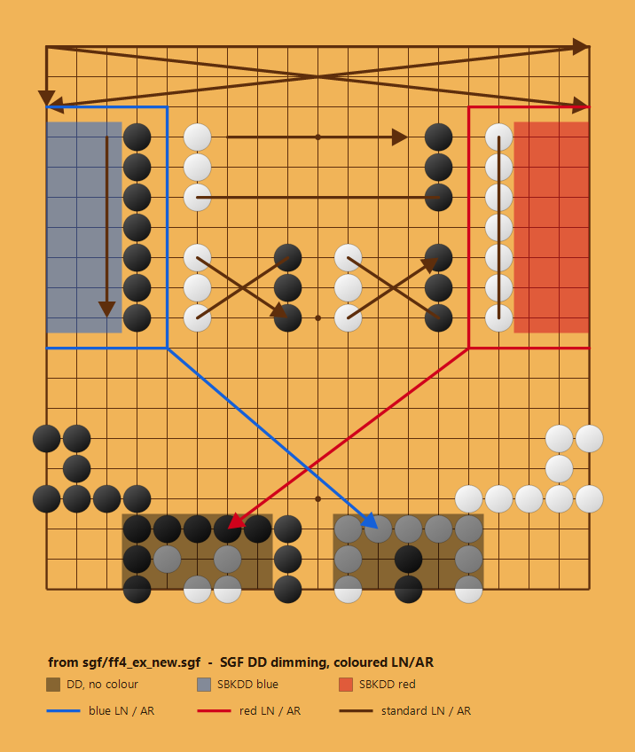

# 

[English](README.md) · **简体中文**

> ## ⚠️ 个人分支 —— 学习项目，并非 Sabaki
>
> 本仓库是 [SabakiHQ/Sabaki](https://github.com/SabakiHQ/Sabaki) 的**分支（fork）**，
> 仅用于**自学**。它是用来试验代码的工作台，**不是维护中的发行版**。
>
> - **此处的改动并不稳定。** 提交可能被重写，功能可能失效或被移除，且未经任何人审核。
> - **任何认真用途 —— 对弈、复盘、注释棋谱 —— 请使用原项目 Sabaki：**
>   <https://github.com/SabakiHQ/Sabaki>。
> - **许可证遵循原项目：** MIT，见 [LICENSE.md](LICENSE.md)。
>   版权仍归 Yichuan Shen 与 Sabaki 贡献者所有；本分支不主张任何新的权利。
>
> ### 本分支新增的功能
>
> 注释工具，外加一项易用性修正：
>
> - **彩色线与箭头** —— 选用「线」或「箭头」工具时提供六色调色板，颜色以可选的第三个
>   SGF 字段保存（`AR[dd:pq:red]`）。
> - **遮罩工具（SGF `DD`）** —— 拖出矩形把该区域变暗。使用标准的可继承 `DD` 属性，
>   颜色存放在私有的 `SBKDD` 伴生属性中，因此其他软件仍会遮罩正确区域。
> - **逐个删除** —— 右键删除鼠标所指的那条线段，或最上层（最新）的遮罩矩形。
> - **对话框记住文件夹** —— 「打开」与「另存为」会从上次所在的目录开始，
>   而不是回到系统默认位置。
>
> 其余部分均为上游 Sabaki，意图上未作改动。

## 颜色与遮罩

此图由 [`sgf/ff4_ex_new.sgf`](sgf/ff4_ex_new.sgf) 渲染而来 —— 也就是把 SGF FF[4]
一致性示例文件用 my-Sabaki 保存回来的结果 —— 因此它展示的正是程序实际写入磁盘的内容：

- **彩色线与箭头。** 图中的蓝色与红色标记就是普通的 `LN`／`AR` 值，只是在末尾附加了
  可选的颜色字段：`AR[ok:gq:red]`、`LN[ec:ak:blue]`。去掉这个后缀，文件又回到纯
  FF[4]，其他软件仍会照常绘制这些标记。
- **遮罩区域。** 矩形来自标准的可继承 `DD` 属性
  （`DD[kq:os][dq:hs][ad:cj][qd:sj]`）。颜色并没有塞进 `DD`，而是放在私有的 `SBKDD`
  伴生属性中（`SBKDD[blue:ad:cj][red:qd:sj]`）。因此只认识 `DD` 的软件依然会遮罩正确
  区域 —— 只是用它自己的颜色。底部两个矩形没有 `SBKDD` 条目，使用主题默认的遮罩色。
- **共存。** 未着色的线与箭头本来就在示例文件中；同一节点内，彩色与未着色标记可以自由
  混用。

## 功能特性

- 落子位置轻微随机（fuzzy stone placement）
- 读写 SGF 棋谱与棋谱集，可打开 wBaduk NGF 与 Tygem GIB 文件
- 以
  [Markdown 子集](https://github.com/SabakiHQ/Sabaki/blob/master/docs/guides/markdown.md)
  呈现格式化注释，并可标注棋盘位置与着法
- 通过
  [纹理与主题](https://github.com/SabakiHQ/Sabaki/blob/master/docs/guides/theme-directory.md)
  个性化棋盘外观
- SGF 编辑工具，包含线与箭头的棋盘标记
- 复制与粘贴变化图
- 强大的撤销／重做
- 快速的对局树
- 形势判断与点目工具
- 按着法位置与注释文字查找
- 支持
  [GTP 引擎](https://github.com/SabakiHQ/Sabaki/blob/master/docs/guides/engines.md)，
  并对支持的引擎提供
  [棋盘分析](https://github.com/SabakiHQ/Sabaki/blob/master/docs/guides/engine-analysis-integration.md)
- 猜棋模式
- 自动播放棋谱

## 文档

更多信息请见
[文档](https://github.com/SabakiHQ/Sabaki/blob/master/docs/README.md)。欢迎为本项目
[贡献](https://github.com/SabakiHQ/Sabaki/blob/master/CONTRIBUTING.md)。

## 构建与测试

参见文档中的
[构建与测试](https://github.com/SabakiHQ/Sabaki/blob/master/docs/guides/building-tests.md)。

## 许可证

本项目采用
[MIT 许可证](https://github.com/SabakiHQ/Sabaki/blob/master/LICENSE.md)。

本分支保持该许可证不变：以同样的 MIT 条款分发，[LICENSE.md](LICENSE.md) 中的原始版权
声明完全适用。使用本仓库并不授予超出原项目许可范围的任何 Sabaki 名称使用权。

## 捐赠者

感谢以下这些可爱的人：

- Eric Wainwright
- Michael Noll
- John Hager
- Azim Palmer
- Nicolas Puyaubreau
- Hans Christian Poerschke
- David Göbel
- Dominik Olszewski
- Brian Weaver
- Philippe Fanaro
- James Tudor
- Frank Orben
- Dekun Song
- Dimitri Rusin
- Andrew Thieman
- Adrian Petrescu
- Karlheinz Agsteiner
- Petr Růžička
- Sergio Villegas
- Jake Pivnik

## 相关项目

- [Shudan](https://github.com/SabakiHQ/Shudan) —— 高度可定制、底层的 Preact 棋盘组件。
- [boardmatcher](https://github.com/SabakiHQ/boardmatcher) —— 在棋盘布局中查找棋形，
  并为着法命名。
- [deadstones](https://github.com/SabakiHQ/deadstones) —— 用蒙特卡洛方法判断死子。
- [go-board](https://github.com/SabakiHQ/go-board) —— 围棋棋盘数据类型。
- [gtp](https://github.com/SabakiHQ/gtp) —— 处理 GTP 引擎的 Node.js 模块。
- [immutable-gametree](https://github.com/SabakiHQ/immutable-gametree) —— 不可变对局树
  数据类型。
- [influence](https://github.com/SabakiHQ/influence) —— 估算影响力分布的简单启发式方法。
- [sgf](https://github.com/SabakiHQ/sgf) —— 解析与生成 SGF 文件的库。
